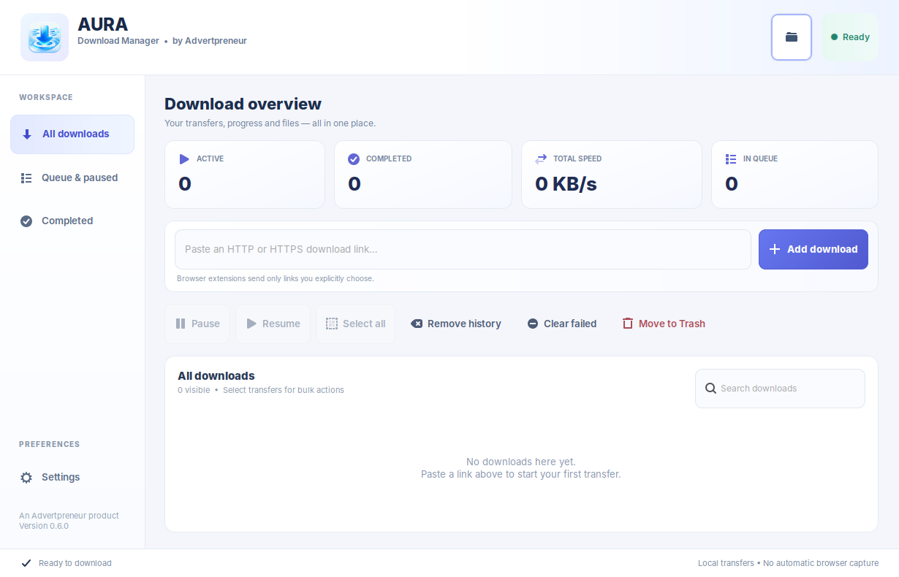
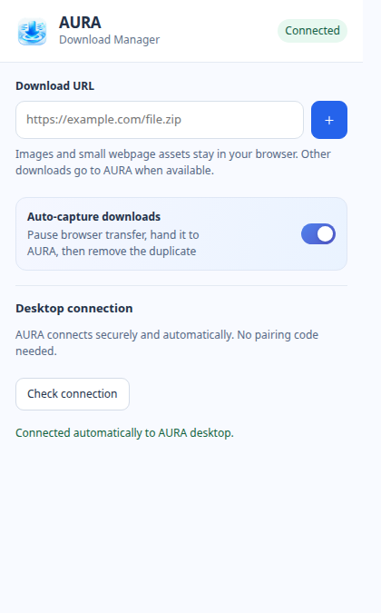

<p align="center">
  
</p>

<h1 align="center">AURA Download Manager</h1>

<p align="center">
  <strong>Fast downloads. A calmer desktop. By Advertpreneur.</strong><br>
  A local-first download manager for Linux and Windows, with Chrome and Firefox integration.
</p>

<p align="center">
  <a href="https://github.com/haseebgb92/AURA-Download-Manager/releases/latest"></a>
  <a href="https://github.com/haseebgb92/AURA-Download-Manager/actions/workflows/source-checks.yml"></a>
  
</p>

<p align="center">
  <a href="https://github.com/haseebgb92/AURA-Download-Manager/releases/latest"><strong>Download latest release</strong></a>
  &nbsp;·&nbsp;
  <a href="https://haseebgb92.github.io/AURA-Download-Manager/">Product website</a>
  &nbsp;·&nbsp;
  <a href="https://github.com/haseebgb92/AURA-Download-Manager/issues">Report an issue</a>
</p>

---

## Screenshots

<table>
  <tr><th width="70%">Linux desktop</th><th width="30%">Browser extension</th></tr>
  <tr>
    <td valign="top"></td>
    <td valign="top"></td>
  </tr>
  <tr>
    <td><sub>Native Linux GTK interface, captured from the v0.6 desktop family with an empty queue.</sub></td>
    <td><sub>Current extension interface, rendered in an isolated browser profile with a simulated connected state.</sub></td>
  </tr>
</table>

The screenshots contain no personal download history, credentials or private browser tabs. Windows uses a separate Qt interface; a Windows screenshot will be added after field testing.

## Highlights

- **Fast managed transfers:** independent open-source [aria2](https://github.com/aria2/aria2) engine, parallel HTTP(S) downloads, pause, resume, queues and bandwidth limits.
- **Automatic capture:** Chrome and Firefox can hand eligible downloads to AURA. **Images stay in the browser by default**, as do fonts, scripts and small webpage assets.
- **Download with AURA:** right-click links or images to download explicitly—even if auto-capture is off.
- **Zero-code connection:** local browser native messaging; no pairing code and no browser access to the private desktop credential.
- **Native UI:** download status, search, history, bulk controls, compact Settings, AURA icon and blue-violet gradients.
- **Controlled updates:** checks official GitHub Releases without silently replacing files or restarting the app.

AURA is developed by **Advertpreneur**. aria2 is an independent download engine with its own [license and source](third_party/aria2/README.md).

## Downloads and installation

| Platform | Download | Packaging |
| --- | --- | --- |
| **Linux** | [Latest Linux archive](https://github.com/haseebgb92/AURA-Download-Manager/releases/latest) | Native GTK app and installer script |
| **Windows 10/11** | [Latest Windows ZIP](https://github.com/haseebgb92/AURA-Download-Manager/releases/latest) | Qt desktop app, currently unsigned |

GitHub releases include SHA-256 checksums. The Windows package passes automated startup tests but has not yet been manually tested on a Windows PC.

### Linux Mint, Ubuntu, Debian

From your terminal:

```bash
sudo apt install aria2 python3-gi gir1.2-gtk-3.0 gir1.2-ayatanaappindicator3-0.1
git clone https://github.com/haseebgb92/AURA-Download-Manager.git
cd AURA-Download-Manager
bash scripts/install-linux.sh
```

Alternatively, extract the Linux release archive and run `bash scripts/install-linux.sh` inside it.

The installer registers the desktop launcher, AURA icon and browser helper; makes a timestamped backup of the existing UI file; and **does not delete downloads, history, credentials or sessions**. Relaunch AURA after installing.

### Windows

Download the latest **Windows-x64.zip**, extract the entire archive, then start `AURA-Download-Manager.exe`. Keep `AURA-Native-Host.exe`, the `_internal` directory and extension folders together.

The app is currently unsigned. Windows SmartScreen may warn; verify the release source and checksums before opening it.

## Chrome and Firefox extensions

**Chrome:** open `chrome://extensions`, enable **Developer mode**, choose **Load unpacked**, and select the project's `chrome/` folder. Install/start the desktop app and reload the extension. If the extension was added after AURA's native messaging host was registered, rerun the Linux installer or restart AURA on Windows once.

**Firefox:** the add-on source is in `firefox/`. You can load it temporarily using `about:debugging` for testing. Permanent distribution requires Mozilla signing.

The extension has an **Auto-capture downloads** switch, enabled by default. Eligible browser transfers pause while AURA confirms that it accepted the download. Chrome or Firefox cancels the browser copy after confirmation; if AURA is unavailable or rejects the handoff, it attempts to resume the browser download.

Images and common webpage assets remain in the browser. **Download with AURA** is available from the right-click menu for links and images. Downloads requiring cookies, login state or POST requests may need to stay in the browser.

## Source layout

| Path | Contains |
| --- | --- |
| `desktop/linux/` | Linux GTK desktop |
| `desktop/windows/` | Windows Qt desktop |
| `desktop/common/` | Update service, native messaging, host registration |
| `chrome/`, `firefox/` | Browser extensions |
| `scripts/` | Install and registration helpers |
| `assets/` | Brand icon and documentation screenshots |
| `docs/` | GitHub Pages product website |
| `tests/` | Source and browser integration tests |
| `.github/workflows/` | CI, Windows builds and release automation |

## Privacy and security

AURA's desktop bridge and aria2 RPC bind to `127.0.0.1`, not the public network. The browser-native host uses a restricted extension allowlist. Neither an Advertpreneur cloud service nor the browser extension receives your downloaded files. Never commit or share `bridge.token`, `aria2.secret`, cookies or session data.

## Version history

<details>
<summary>Recent releases (v0.6.1–v0.6.4)</summary>

- **v0.6.4** — automatic download capture, image exclusions and the browser on/off switch.
- **v0.6.3** — local native messaging and automatic browser pairing.
- **v0.6.2** — compact two-column Linux Settings.
- **v0.6.1** — Linux icon registration and more visible gradients.

[All releases](https://github.com/haseebgb92/AURA-Download-Manager/releases).

</details>

## Development and contributions

```bash
python3 -m py_compile desktop/linux/app.py desktop/windows/app.py
python3 -m unittest discover -s tests -p 'test_native_host.py'
python3 -m unittest discover -s tests -p 'test_update_service.py'
node --test tests/extension-worker.test.cjs
```

Issues and suggestions are welcome. **This repository does not yet have an open-source license.** Public visibility does not grant reuse or redistribution rights; the project owner can add a license separately.

---

<p align="center"><sub>Made by <strong>Advertpreneur</strong> · Commerce. Growth. Technology.</sub></p>
